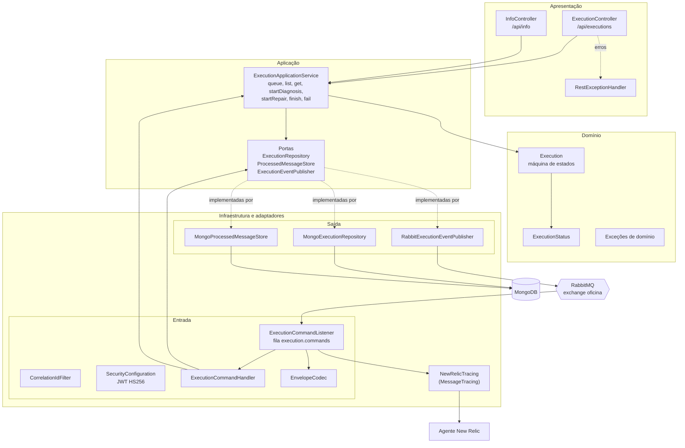
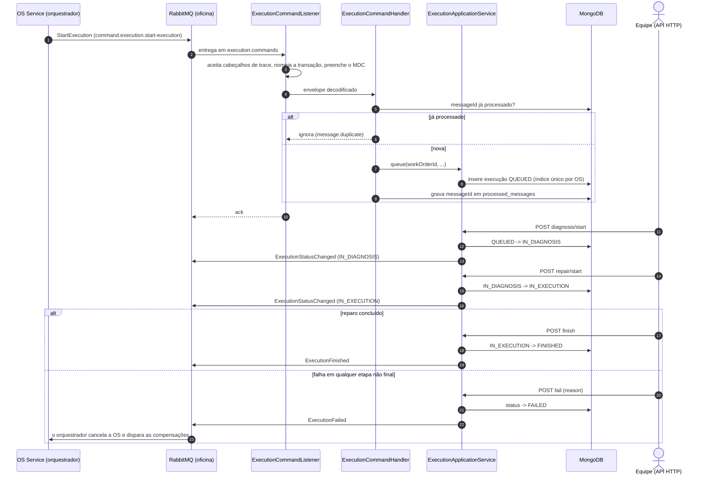
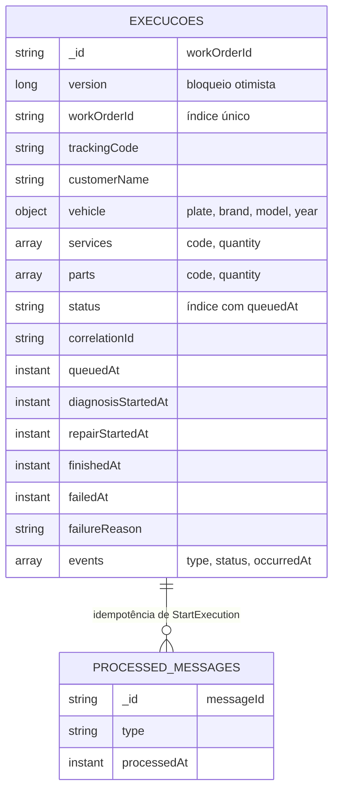
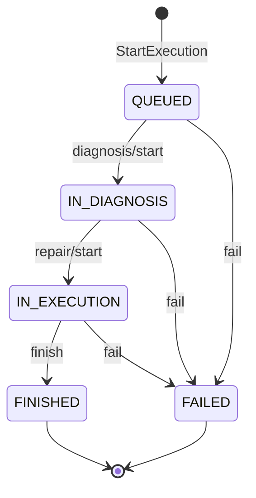

# Arquitetura do Execution Service

O serviço guarda a execução de cada ordem de serviço (OS) e participa da saga orquestrada pelo
OS Service. Não acessa o banco de outro serviço: conversa com os demais só pelo contrato de
mensagens no RabbitMQ. A visão geral e como rodar estão no [README](../README.md).

## Componentes por camada

As dependências apontam para dentro: a infraestrutura implementa as portas definidas na
aplicação, e o domínio não conhece Spring, MongoDB nem RabbitMQ. O adaptador `NewRelicTracing`
isola a API do New Relic atrás da interface `MessageTracing`; sem o agente ela não faz nada.

## Participação na saga

Cada evento é publicado depois de gravar o documento, com o `correlationId` recebido em
`StartExecution`. Mensagem ilegível ou de `type` desconhecido vai direto para a DLQ
(`execution.commands.dlq`); outras falhas passam por três tentativas antes de ir para a DLQ.

## Modelo de dados

`processed_messages` não tem chave estrangeira: a relação é lógica (o `messageId` consumido
produziu, no máximo, uma execução). O MongoDB do cluster é standalone, sem transação
multidocumento, por isso cada escrita é de um único documento e o efeito de cada mensagem é
idempotente por si.

### Estados da execução

